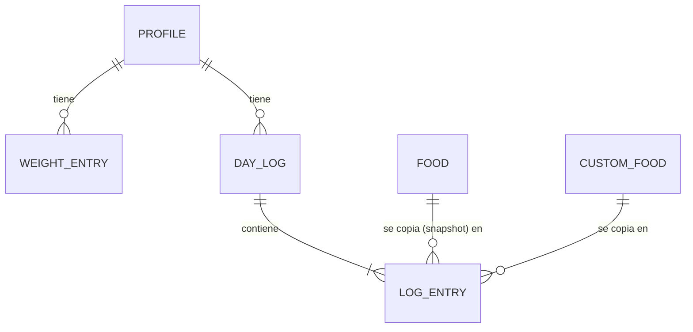
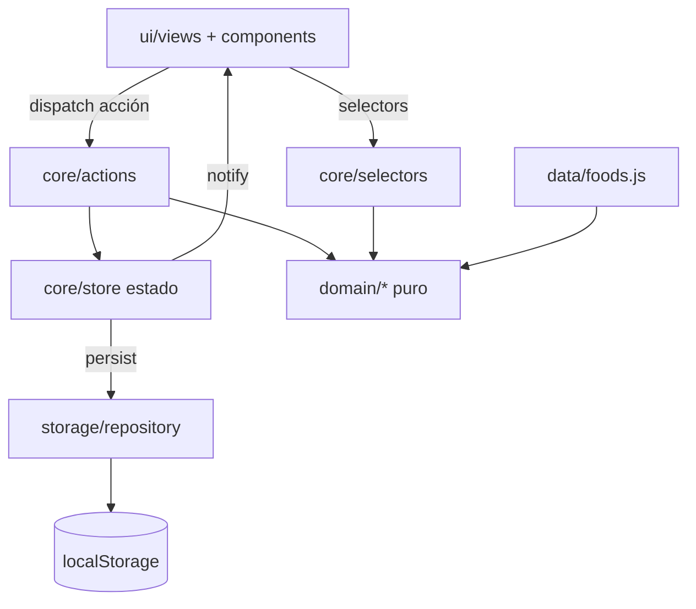
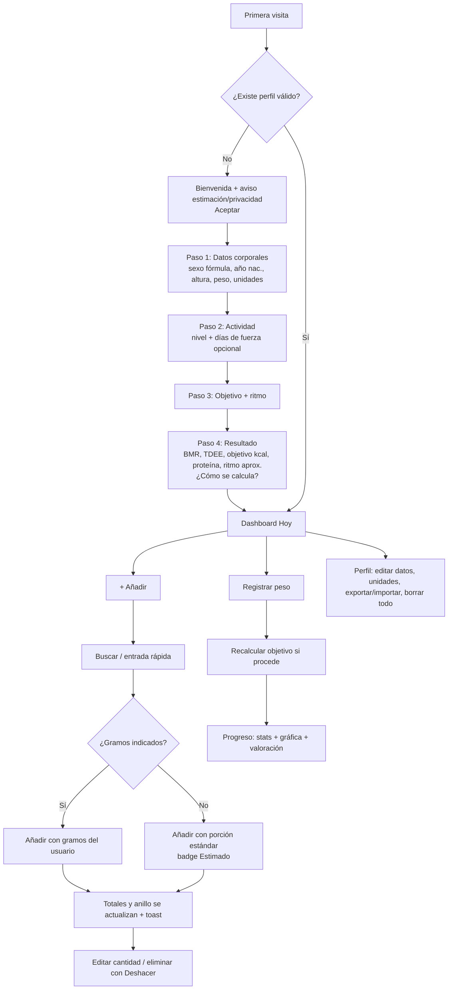

# NutriTrack — Especificación Técnica de Producto (TPS) para implementación en HTML/CSS/JS vanilla

Documento maestro que define producto, metodología nutricional con fuentes, fórmulas, modelo de datos, arquitectura modular vanilla JS, UX/UI, backlog ágil, roadmap, testing y criterios de aceptación para que Claude Opus implemente una app web local-first de seguimiento de calorías y peso.

## 0. Contexto del workspace y alcance de este documento

- El directorio actual `C:\Users\USUARIO\Documents\proyecto x` **ya contiene otro proyecto no relacionado** ("Sustancia X — novela visual": `index.html`, `css/style.css`, `js/engine.js|story.js|characters.js`, `test_drive.js`). No es un repo git. **La nueva app NO debe sobrescribir esos archivos.** Propuesta por defecto: crear todo dentro de una subcarpeta nueva `nutri-app/` (ver "Preguntas y decisiones pendientes").
- Nombre de trabajo: **NutriTrack** (provisional).
- Este documento es la **especificación maestra de implementación**. Claude Opus (o quien implemente) debe trabajar dentro de `nutri-app/` siguiendo el backlog de §19 y las instrucciones de §30. **No se ha escrito aún código de la aplicación.**
- Convención de etiquetas usadas en todo el documento:
  - **[EVIDENCIA]** respaldado por literatura/organismos (ver §35).
  - **[ESTIMACIÓN]** cálculo aproximado con error conocido.
  - **[DISEÑO]** decisión de producto/ingeniería tomada por nosotros (discutible, no científica).
  - **[SUPUESTO]** hipótesis del producto a validar.

---

## 1. Resumen ejecutivo

NutriTrack es una aplicación web **local-first**, sin backend, construida con **HTML + CSS + JavaScript vanilla (ES Modules)**, que permite a un adulto:
1. Configurar un perfil mínimo (sexo para la fórmula, año de nacimiento, altura, peso, actividad, objetivo).
2. Obtener un **objetivo calórico diario estimado** (Mifflin-St Jeor × factor de actividad ± ajuste por objetivo) y un **objetivo de proteína**.
3. Registrar alimentos en 4 comidas (Desayuno, Almuerzo, Cena, Snack) escribiendo nombre + gramos, o solo el nombre (usa **porción estándar**, marcada como estimación).
4. Ver en segundos: **Objetivo / Consumido / Restante** y progreso visual.
5. Registrar peso y ver **peso actual, inicial, diferencia absoluta y %, media semanal, tendencia suavizada** y una gráfica que separa **fluctuación diaria** de **tendencia**.

Decisiones clave:
- **Vanilla JS con ES Modules**, sin frameworks ni dependencias en runtime. Gráficas en **SVG propio**.
- **localStorage** con capa de repositorio, esquema versionado, validación y migraciones (IndexedDB queda como V2 si el volumen lo exige).
- **Mifflin-St Jeor** como fórmula de BMR (la más precisa de las de uso común en la revisión sistemática de la ADA, Frankenfield 2005).
- **MVP = calorías + proteína**. Carbohidratos y grasas se almacenan y se muestran como totales, pero sus **objetivos** entran en V1.
- **Tendencia de peso con media móvil exponencial (EMA)** y regla de "no concluir con < 14 días".
- Metodología **Scrumban** con iteraciones semanales para 1 persona + IA.
- La app se presenta como **herramienta de estimación**, nunca como consejo médico.

---

## 2. Visión del producto

> "Saber cada día, en menos de 5 segundos, cuántas calorías llevo y cuántas me faltan; y cada semana, si mi peso va en la dirección de mi objetivo, sin confundir ruido con progreso."

Principios de producto [DISEÑO]:
1. **Rapidez sobre exhaustividad**: registrar un alimento en ≤ 3 interacciones.
2. **Honestidad numérica**: todo valor estimado se marca (≈, badge "Estimado", fuente visible).
3. **Privacidad por defecto**: datos solo en el dispositivo.
4. **Sin culpa**: exceder el objetivo se comunica en ámbar informativo, no en rojo alarmante.
5. **Pequeño y sólido**: MVP reducido, bien probado, extensible.

---

## 3. Problema que resuelve

| Problema | Cómo lo resuelve |
|---|---|
| El usuario no sabe cuánto come realmente | Registro por comida con totales diarios |
| Pesar todo es tedioso | Porción estándar por alimento + edición posterior |
| Las calculadoras dan un número sin contexto | Se muestra BMR, TDEE, ajuste, y explicación/limitaciones |
| La báscula "sube" un día y desmotiva | Tendencia suavizada + mensajes que distinguen fluctuación de cambio real |
| Apps comerciales exigen cuenta y suben datos | Local-first, sin cuenta, exportable y borrable |

---

## 4. Usuarios objetivo

- **Primario**: adulto (18–80 años), sano, con interés en perder grasa, ganar músculo o recomponer; usa principalmente el móvil; puede o no entrenar fuerza.
- **Secundario**: usuario que entrena con regularidad y quiere controlar proteína.
- **Fuera de alcance explícito** (se muestra aviso y se bloquea/limita): menores de 18, embarazo/lactancia, personas con TCA (trastornos de conducta alimentaria), enfermedad renal, diabetes u otras condiciones que requieran pauta clínica. [DISEÑO + ÉTICA] Las ecuaciones no son válidas para crecimiento/embarazo (FAO/WHO/UNU 2004 usa cálculos específicos) y el conteo calórico puede ser contraproducente en TCA.

Personas:
- **Laura, 29, oficina, pérdida de grasa**: registra desde el móvil en el almuerzo; quiere saber "cuánto me queda para la cena".
- **Andrés, 24, gimnasio 4 días, ganancia muscular**: le importa llegar a la proteína y a un superávit pequeño.
- **Marta, 41, recomposición**: peso estable; necesita que la app no la desanime cuando la báscula no se mueve.

---

## 5. Requisitos funcionales (RF)

Prioridad MoSCoW dentro del MVP: M = Must, S = Should. (C/W = V1/V2.)

| ID | Requisito | Prio | Versión |
|---|---|---|---|
| RF-01 | Onboarding con aviso de estimación/privacidad y aceptación | M | MVP |
| RF-02 | Perfil: sexo para fórmula, año nacimiento, altura, peso, actividad, objetivo, ritmo; alias y días de entrenamiento opcionales | M | MVP |
| RF-03 | Cálculo BMR, TDEE, objetivo kcal, objetivo proteína con explicación | M | MVP |
| RF-04 | Editar perfil y recalcular objetivos | M | MVP |
| RF-05 | Base de alimentos local (~120–150 alimentos) con macros por 100 g/ml y porciones | M | MVP |
| RF-06 | Búsqueda tolerante a tildes/mayúsculas por nombre y alias | M | MVP |
| RF-07 | Añadir alimento a una comida con gramos o con porción estándar | M | MVP |
| RF-08 | Entrada rápida de texto "arroz 200 g" / "200g arroz" / "arroz" | S | MVP |
| RF-09 | Editar cantidad (y comida) de una entrada; eliminar con "Deshacer" | M | MVP |
| RF-10 | Crear alimento personalizado (nombre, kcal y macros por 100 g, porción) | M | MVP |
| RF-11 | Navegar a días anteriores y registrar/editar en ellos | M | MVP |
| RF-12 | Dashboard: objetivo/consumido/restante/% + proteína + subtotales por comida | M | MVP |
| RF-13 | Registrar peso (1 por día), editar, eliminar | M | MVP |
| RF-14 | Estadísticas de peso: actual, inicial, dif. abs. y %, media semanal, ritmo semanal de tendencia | M | MVP |
| RF-15 | Gráfica de peso (puntos + línea de tendencia) con alternativa accesible | M | MVP |
| RF-16 | Recalcular objetivo automáticamente con el peso de tendencia | S | MVP |
| RF-17 | Aviso de privacidad y "Eliminar todos mis datos" con confirmación fuerte | M | MVP |
| RF-18 | Exportar / importar datos (JSON) | S | MVP |
| RF-19 | Unidades kg/lb y cm/ft-in (almacenamiento interno siempre métrico) | S | MVP |
| RF-20 | Recordatorio in-app si pasan > 7 días sin registrar peso | S | MVP |
| RF-21 | Objetivos de carbohidratos y grasas | C | V1 |
| RF-22 | Alimentos recientes/favoritos, copiar comida de otro día | C | V1 |
| RF-23 | TDEE adaptativo (a partir de ingesta registrada y tendencia de peso) | C | V1 |
| RF-24 | Katch-McArdle si el usuario aporta % grasa | C | V1 |
| RF-25 | Modo oscuro | C | V1 |
| RF-26 | PWA offline instalable, recetas, escaneo de código de barras, sincronización | W | V2 |

---

## 6. Requisitos no funcionales (RNF)

| ID | Requisito | Métrica/criterio |
|---|---|---|
| RNF-01 | Sin frameworks ni dependencias runtime | `package.json` solo con devDeps opcionales (ninguna obligatoria) |
| RNF-02 | Rendimiento | Primera carga < 1 s en móvil medio con servidor local; búsqueda < 50 ms con 500 alimentos; JS total sin minificar < 150 KB (sin contar foods.js) |
| RNF-03 | Accesibilidad | WCAG 2.2 AA (ver §26) |
| RNF-04 | Responsive | 320 px – 1920 px sin scroll horizontal |
| RNF-05 | Privacidad | 0 peticiones de red a terceros; sin analítica; sin fuentes/CDN externos |
| RNF-06 | Robustez | La app nunca queda en blanco por datos corruptos: pantalla de recuperación |
| RNF-07 | Mantenibilidad | Ningún archivo JS > 400 líneas; lógica de dominio pura (sin DOM) y testeada |
| RNF-08 | Compatibilidad | Últimas 2 versiones de Chrome, Edge, Firefox, Safari (iOS 16+) |
| RNF-09 | Seguridad | Sin `eval`, `new Function`, `innerHTML` con datos del usuario; CSP estricta |
| RNF-10 | Idioma | Español; formato numérico `es` (coma decimal) vía `Intl.NumberFormat`; textos centralizados en `js/i18n/es.js` para permitir otros idiomas en el futuro |

---

## 7. Metodología nutricional

### 7.1 BMR/TMB — elección de fórmula

| Fórmula | Datos | Valoración |
|---|---|---|
| **Mifflin-St Jeor (1990)** | sexo, peso, altura, edad | **[EVIDENCIA]** En la revisión sistemática de la ADA (Frankenfield 2005) fue la más fiable: predijo el RMR dentro de ±10 % del medido en más individuos (obesos y no obesos) que Harris-Benedict, Owen y WHO/FAO/UNU, y con el rango de error más estrecho. |
| Harris-Benedict (1919, rev. 1984) | ídem | Tiende a sobreestimar en población actual; peor que Mifflin en la misma revisión. |
| WHO/FAO/UNU (Schofield) | sexo, edad, peso | Útil a nivel poblacional; sin validación suficiente a nivel individual según Frankenfield 2005. |
| Katch-McArdle / Cunningham | masa magra | Más precisa en personas con % grasa conocido y fiable (atletas), pero exige un dato que la mayoría no tiene o mide mal (básculas de bioimpedancia). → **V1 opcional**. |

**Decisión**: Mifflin-St Jeor en MVP. [EVIDENCIA + DISEÑO]

**Limitaciones que la app debe comunicar** (texto en pantalla "¿Cómo se calcula?"):
- Error individual típico de ±10 % o más; aproximadamente 1 de cada 5 personas queda fuera de ese margen. [EVIDENCIA, Frankenfield 2005]
- Menor precisión en adultos mayores, minorías étnicas poco representadas en los estudios de validación, personas con obesidad severa y atletas muy musculados. [EVIDENCIA]
- El número es un **punto de partida**; el ajuste real se hace observando la tendencia de peso 2–4 semanas. [DISEÑO basado en Hall 2011]

### 7.2 TDEE — gasto energético diario

TDEE = BMR × factor de actividad (PAL). [ESTIMACIÓN]

La FAO/WHO/UNU (2004) define rangos de PAL sostenibles: sedentario/ligero 1.40–1.69, activo/moderado 1.70–1.99, vigoroso 2.00–2.40. [EVIDENCIA] Las apps suelen usar 5 multiplicadores clásicos (1.2 / 1.375 / 1.55 / 1.725 / 1.9); el 1.2 queda por debajo del rango FAO para personas sanas (representa una vida extremadamente inactiva). **[DISEÑO]** Usaremos los 5 niveles clásicos (ampliamente usados y comprensibles) con descripciones concretas:

| Clave | Etiqueta en UI | Descripción (texto de ayuda) | Factor |
|---|---|---|---|
| `sedentary` | Sedentario | Trabajo sentado, casi sin ejercicio, < 5.000 pasos/día | 1.2 |
| `light` | Ligeramente activo | Trabajo sentado + ejercicio 1–3 días/sem o caminas bastante | 1.375 |
| `moderate` | Moderadamente activo | Ejercicio 3–5 días/sem o trabajo de pie | 1.55 |
| `active` | Muy activo | Ejercicio intenso 6–7 días/sem o trabajo físico | 1.725 |
| `very_active` | Extremadamente activo | Trabajo físico pesado + entrenamiento diario o doble sesión | 1.9 |

Cuestionamiento del requisito original: se pedía "nivel de actividad" **y** "frecuencia de entrenamiento". Si ambos alteraran el TDEE se **contaría el ejercicio dos veces**. **Decisión [DISEÑO]**: el factor de actividad ya incluye el ejercicio; la **frecuencia de entrenamiento de fuerza (opcional)** se usa solo para (a) elegir el objetivo de proteína y (b) mostrar un aviso en recomposición si no entrena fuerza. Además se incluye en la ayuda: "Si dudas entre dos niveles, elige el más bajo" — [EVIDENCIA indirecta] la gente tiende a sobreestimar su actividad.

### 7.3 Objetivo calórico por meta

Constante de conversión solo orientativa: **≈ 7.700 kcal por kg** de tejido perdido/ganado. [ESTIMACIÓN] Hall et al. (Lancet 2011) demuestran que la "regla de las 3.500 kcal/lb" es estática y **sobreestima** la pérdida a medio/largo plazo porque ignora la adaptación del gasto. → La usamos **solo** para mostrar un ritmo esperado inicial, siempre como "aprox." y nunca para predecir fechas.

| Meta (`goal`) | Ajuste sobre TDEE | Ritmo de referencia | Base |
|---|---|---|---|
| Pérdida de grasa `lose` | Ritmo `gentle` −10 %, `moderate` −20 % (**por defecto**), `aggressive` −25 % | 0,5–1 % del peso corporal/semana | Helms 2014: 0,5–1 %/sem para maximizar retención de masa magra [EVIDENCIA]; porcentajes: [DISEÑO] |
| Ganancia muscular `gain` | `gentle` +5 %, `moderate` +10 % (**defecto**), `aggressive` +15 % | ~0,25–0,5 %/sem (novatos/intermedios) | Iraki 2019: superávit ~10–20 %, 0,25–0,5 %/sem [EVIDENCIA]; se limita a 15 % para minimizar grasa [DISEÑO] |
| Recomposición `recomp` | 0 % (mantenimiento) con opción `gentle` −5 % | peso ~estable (±0,25 %/sem) | [DISEÑO]; la recomposición depende sobre todo de entrenamiento de fuerza, proteína alta y descanso (ISSN 2017) |
| Mantener `maintain` | 0 % | estable | Se añade porque el requisito §5 menciona "mantenimiento"; coste nulo |

**Límites de seguridad [DISEÑO basado en práctica clínica común]:**
- `target = max(target, floorKcal)` con `floorKcal = max(BMR_redondeado, 1500 si male | 1200 si female | 1350 si unspecified)`. Umbrales de 1.200/1.500 kcal: cifras mínimas habituales en guías de programas de pérdida de peso (NIH/NHLBI) sin supervisión médica [EVIDENCIA práctica].
- Si se aplicó el suelo → banner: "Tu objetivo se ha ajustado a un mínimo seguro. Considera un ritmo más suave o consulta a un profesional."
- Ritmo `aggressive` en pérdida no disponible si IMC < 18,5 + aviso; si IMC < 18,5 y meta `lose` → aviso fuerte recomendando consultar a un profesional (no se bloquea, pero se preselecciona `maintain`).

### 7.4 Proteína diaria

| Situación | g/kg/día | Base |
|---|---|---|
| Entrena fuerza (≥ 2 días/sem) y meta `lose` o `recomp` | 2,0 | ISSN 2017: 1,4–2,0 g/kg suficiente para la mayoría; valores altos favorecen retención de masa magra en déficit [EVIDENCIA]; valor exacto [DISEÑO] |
| Entrena fuerza y meta `gain`/`maintain` | 1,8 | Iraki 2019: 1,6–2,2 g/kg [EVIDENCIA] |
| No entrena fuerza / no indicado | 1,2 | Por encima de la RDA 0,8 g/kg (IOM 2005), razonable para adultos activos y en déficit [DISEÑO] |

- **Peso de referencia para proteína**: si IMC ≥ 30 se usa `refWeight = 25 × altura_m²` (peso equivalente a IMC 25) para evitar objetivos desproporcionados. [DISEÑO; práctica habitual de usar peso ajustado/ideal en obesidad]
- Proteína se muestra redondeada a múltiplos de 5 g.

### 7.5 Macros restantes (V1, pero se documenta ya)

- Grasa: 25 % de kcal (dentro del AMDR 20–35 %, IOM 2005) con mínimo 0,5 g/kg (Iraki 2019). [EVIDENCIA + DISEÑO]
- Carbohidratos: resto. Atwater: proteína 4, carbohidrato 4, grasa 9, alcohol 7 kcal/g. [EVIDENCIA]

### 7.6 Evolución esperada del peso y fluctuaciones

- Fluctuación intra-semanal media ≈ 0,35 % del peso (más alto lunes, baja durante la semana) (Turicchi 2020). Oscilaciones diarias de 0,5–1,5 kg por agua, glucógeno, sodio, contenido intestinal y ciclo menstrual son normales. [EVIDENCIA]
- La respuesta del peso a un cambio de ingesta es lenta y no lineal (Hall 2011). [EVIDENCIA]
- **Reglas de la app [DISEÑO]:**
  - No mostrar "tendencia" hasta tener ≥ 3 registros que cubran ≥ 7 días.
  - No emitir valoraciones ("vas bien/lento") hasta ≥ 4 registros que cubran ≥ 14 días.
  - Nunca decir "has perdido X kg de grasa"; decir "tu peso de tendencia ha bajado X kg".

### 7.7 Aviso legal (texto obligatorio en onboarding y en Perfil)

"NutriTrack ofrece **estimaciones** basadas en fórmulas poblacionales. No sustituye el consejo de un nutricionista, dietista o médico. No está diseñada para menores de 18 años, embarazo, lactancia ni para personas con trastornos de la conducta alimentaria o enfermedades que requieran una dieta específica."

---

## 8. Fórmulas y cálculos (especificación exacta)

Todas las funciones viven en `js/domain/` y son **puras** (sin DOM, sin storage, sin `Date.now()` implícito: la fecha se inyecta).

### 8.1 Unidades
```
kg = lb × 0,45359237
cm = ft × 30,48 + in × 2,54
lb = kg / 0,45359237
```
Interno: kg (1 decimal de precisión de entrada, se guarda tal cual), cm (entero o 1 decimal).

### 8.2 Edad
```
age = currentYear − birthYear   (fecha inyectada)
```
[DISEÑO] Se pide **año de nacimiento** en lugar de edad para que la edad se actualice sola; el error máximo de 1 año equivale a 5 kcal en Mifflin (irrelevante).

### 8.3 BMR (Mifflin-St Jeor)
```
base = 10 × peso_kg + 6,25 × altura_cm − 5 × edad
BMR  = base + 5      si sex = 'male'
BMR  = base − 161    si sex = 'female'
BMR  = base − 78     si sex = 'unspecified'   [DISEÑO: punto medio, marcado "menos preciso"]
```

### 8.4 TDEE
```
TDEE = BMR × ACTIVITY_FACTOR[activityLevel]
```

### 8.5 Objetivo calórico
```
adj    = GOAL_ADJUSTMENT[goal][pace]        // p.ej. lose.moderate = −0,20
raw    = TDEE × (1 + adj)
floor  = max(round(BMR), SEX_FLOOR[sex])
target = roundTo(max(raw, floor), 10)       // múltiplos de 10 kcal
flags  = { floorApplied: raw < floor }
```

### 8.6 Ritmo esperado (solo informativo)
```
dailyDelta   = target − TDEE                     // negativo = déficit
weeklyKg     = dailyDelta × 7 / 7700             [ESTIMACIÓN]
weeklyPct    = weeklyKg / peso_kg × 100
```
Mostrar como "≈ −0,4 kg/semana al inicio (aprox.)".

### 8.7 Proteína
```
bmi       = peso_kg / (altura_cm/100)²
refWeight = bmi ≥ 30 ? 25 × (altura_cm/100)² : peso_kg
gPerKg    = PROTEIN_TABLE(goal, trainsResistance)
protein   = roundTo(refWeight × gPerKg, 5)
trainsResistance = (resistanceDaysPerWeek ?? 0) ≥ 2
```

### 8.8 Escalado de alimentos
Los valores de referencia se guardan **por 100 g (o 100 ml)**.
```
factor         = gramos / 100
kcal_entrada   = kcal_100 × factor
prot_entrada   = prot_100 × factor     (ídem carbs, grasa, fibra)
```
Si una fuente da valores por porción: `valor_100 = valor_porción × 100 / gramos_porción` (conversión hecha **al construir la base**, nunca en runtime).

Ejemplo: Arroz blanco cocido 130 kcal/100 g; 200 g → 130 × 2 = 260 kcal. Banano porción estándar 118 g con 89 kcal/100 g → 89 × 1,18 = 105,0 kcal.

### 8.9 Totales y progreso
```
consumed   = Σ kcal_entrada (sin redondear)
remaining  = target − consumed
pct        = consumed / target × 100
ringFill   = min(pct, 100)                  // visual
estado     = pct < 90 → 'under' | 90 ≤ pct ≤ 105 → 'on_track' | pct > 105 → 'over'   [DISEÑO]
```
Redondeo **solo en presentación**: kcal a entero; macros a 1 decimal si < 10 g, entero si ≥ 10 g; peso a 1 decimal; porcentajes a entero. Mostrar `remaining < 0` como "Excedido en 120 kcal".

### 8.10 Validación de coherencia de alimentos (script de test)
```
kcalAtwater = 4×P + 4×C + 9×G (+ 7×alcohol)
válido si |kcal − kcalAtwater| ≤ max(0,15 × kcal, 15)
```
Las discrepancias pequeñas son normales (fibra, factores Atwater específicos); por encima del umbral hay que revisar el dato. [DISEÑO]

### 8.11 Peso
Con `W` = lista de registros ordenados por fecha (1 por día).
```
initial      = W[0].kg
current      = W[último].kg
diffAbs      = current − initial
diffPct      = diffAbs / initial × 100
prevDiff     = current − W[penúltimo].kg

// Tendencia EMA con huecos (α = 0,1 por día; inspirada en "The Hacker's Diet") [DISEÑO]
trend[0] = W[0].kg
para i ≥ 1:  Δd = días entre W[i-1] y W[i]
             αeff = 1 − (1 − 0,1)^Δd
             trend[i] = trend[i-1] + αeff × (W[i].kg − trend[i-1])

// Media semanal
weekAvg(semana) = media de registros en esa semana ISO (lunes–domingo)
weekChange      = weekAvg(semana actual) − weekAvg(semana anterior)  (si ambas tienen ≥ 1 registro)

// Ritmo de tendencia (kg/semana): pendiente por mínimos cuadrados de (día, kg)
// sobre registros de los últimos 28 días; requiere ≥ 4 registros y ≥ 14 días de amplitud
slopePerDay = Σ((x−x̄)(y−ȳ)) / Σ((x−x̄)²)
ratePerWeek = slopePerDay × 7 ; ratePctWeek = ratePerWeek / trendActual × 100
```
Evaluación frente al objetivo [DISEÑO basado en §7.3]:

| Meta | Rango esperado (%/sem) | Mensaje si dentro | Si fuera |
|---|---|---|---|
| lose | −1,0 a −0,25 | "Tu tendencia baja a un ritmo acorde a tu objetivo." | > −0,25: "La tendencia apenas baja. Revisa registro 2 semanas más antes de ajustar." < −1,0: "Bajas más rápido de lo recomendado; considera comer un poco más." |
| gain | +0,1 a +0,5 | "Ganas peso a un ritmo razonable." | análogos |
| recomp / maintain | −0,25 a +0,25 | "Tu peso se mantiene estable, lo esperado." | análogos |

Si no hay datos suficientes: "Necesitamos al menos 2 semanas de registros para valorar tu tendencia."

### 8.12 Peso usado en los cálculos
`weightForCalc = trend actual si hay ≥ 3 registros, si no el último registro`. Al registrar un peso se recalculan los objetivos; si el objetivo cambia ≥ 50 kcal se muestra toast "Tu objetivo diario se actualizó a X kcal". [DISEÑO]

### 8.13 Vectores de prueba (deben estar en tests)
| Caso | Entrada | BMR | TDEE | Objetivo |
|---|---|---|---|---|
| A | male, 30 años, 80 kg, 180 cm, moderate, lose/moderate | 1780 | 2759 | 2207 → **2210** |
| B | female, 25 años, 60 kg, 165 cm, light, maintain | 1345,25 | 1849,72 | **1850** |
| C | female, 60 años, 50 kg, 150 cm, sedentary, lose/aggressive | 976,5 | 1171,8 | raw 878,85 → suelo 1200, `floorApplied=true` |
| D | unspecified, 40 años, 70 kg, 170 cm, moderate, gain/moderate | 1484,5 | 2300,98 | 2531 → **2530** |
Proteína A (entrena 4 días, lose): 80 × 2,0 = **160 g**. Caso IMC ≥ 30: 120 kg, 175 cm → IMC 39,2 → ref 76,56 kg × 2,0 = 153,1 → **155 g**.

---

## 9. Modelo de datos

Todos los objetos persistidos llevan tipos primitivos JSON; fechas de día como `YYYY-MM-DD` **en hora local** (nunca `toISOString().slice(0,10)`, que usa UTC y rompe días cerca de medianoche); timestamps como ISO string.

### 9.1 Food (base estática y personalizados)
```js
{
  id: "arroz-blanco-cocido",          // slug estable; personalizados: "custom-<uuid>"
  name: "Arroz blanco cocido",
  aliases: ["arroz", "arroz blanco"],
  category: "cereales",               // enum FOOD_CATEGORIES
  unit: "g",                          // "g" | "ml"
  per100: { kcal: 130, protein: 2.7, carbs: 28.2, fat: 0.3, fiber: 0.4 }, // fiber opcional
  defaultPortion: { grams: 150, label: "1 taza" },
  portions: [ { label: "1/2 taza", grams: 75 }, { label: "1 taza", grams: 150 } ],
  source: { name: "USDA FoodData Central (SR Legacy)", ref: "<fdcId real>", retrieved: "2026-09" },
  portionSource: "USDA FNDDS / ICBF / estimación propia",
  isCustom: false
}
```
(Valores ilustrativos; los reales se obtienen en la Fase 0. **Prohibido inventar IDs de fuente.**)

### 9.2 Profile
```js
{
  alias: "Laura" | null,
  sex: "male" | "female" | "unspecified",
  birthYear: 1996,
  heightCm: 165,
  activityLevel: "sedentary" | "light" | "moderate" | "active" | "very_active",
  resistanceDaysPerWeek: 0..7 | null,
  goal: "lose" | "gain" | "recomp" | "maintain",
  pace: "gentle" | "moderate" | "aggressive",
  disclaimerAcceptedAt: "2026-09-24T10:00:00.000Z",
  createdAt, updatedAt
}
```
El **peso no vive en el perfil**: vive en `weights` (el onboarding crea el primer registro). Evita dos fuentes de verdad.

### 9.3 Settings
```js
{ weightUnit: "kg" | "lb", heightUnit: "cm" | "ftin", theme: "light" /* V1: "dark"|"system" */ }
```

### 9.4 DayLog y LogEntry
```js
DayLog = {
  date: "2026-09-24",
  entries: LogEntry[],
  targetSnapshot: { kcal: 2210, protein: 160 }  // objetivo vigente cuando se editó por última vez
}
LogEntry = {
  id: "uuid",
  meal: "breakfast" | "lunch" | "dinner" | "snack",
  foodId: "arroz-blanco-cocido",
  foodName: "Arroz blanco cocido",          // snapshot
  unit: "g",
  grams: 200,
  quantitySource: "user" | "default",        // introducida vs porción estándar
  portionLabel: "1 taza" | null,
  per100: { kcal, protein, carbs, fat },     // snapshot → el historial no cambia si se edita la base
  sourceName: "USDA FoodData Central",       // snapshot
  createdAt, updatedAt
}
```
Los nutrientes de la entrada **no se guardan**, se derivan de `per100 × grams/100` (una sola fuente de verdad).

Por qué snapshot: si en una versión futura corrigen el arroz de 130 a 128 kcal, los días pasados no cambian retroactivamente. [DISEÑO]

### 9.5 WeightEntry
```js
{ id: "uuid", date: "2026-09-24", kg: 79.5, createdAt, updatedAt }
```
Restricción: único por `date`.

### 9.6 Derivados (NO se persisten)
`targets {bmr, tdee, kcal, protein, floorApplied, expectedWeeklyKg}`, `dayTotals`, `mealTotals`, `weightStats {initial, current, diffAbs, diffPct, trendSeries, weekChange, ratePerWeek, assessment}`.

### 9.7 Diagrama


---

## 10. Arquitectura frontend

### 10.1 Decisiones
- **ES Modules nativos** (`<script type="module" src="js/main.js">`). Sin bundler. Requiere servir por HTTP (no `file://`) → ver decisiones pendientes. [DISEÑO]
- **Capas** (dependencias solo hacia abajo):
  1. `ui/views` y `ui/components` — render y eventos DOM.
  2. `core` — store (estado + pub/sub), router hash, acciones.
  3. `domain` — lógica pura (cálculos, búsqueda, parseo, validación). **Testeable en Node.**
  4. `storage` — repositorio sobre localStorage, migraciones, esquema.
  5. `data` — base de alimentos estática.
- **Renderizado**: componentes como funciones `createX(props) → HTMLElement` usando un helper `h(tag, attrs, ...children)` que usa `createElement`/`textContent`. Cada vista se suscribe al store y re-renderiza su sección (granularidad por card). Sin virtual DOM. Delegación de eventos en contenedores.
- **Router hash**: `#/hoy` (por defecto), `#/hoy/2026-09-20`, `#/progreso`, `#/perfil`, `#/onboarding/<paso>`. Guard: sin perfil → onboarding.



### 10.2 Contratos principales
```
// core/store.js
createStore(initialState) → { getState(), setState(updater, {persist:true}), subscribe(fn) → unsubscribe }

// core/actions.js (única vía para mutar)
saveProfile(profileInput)           addEntry(date, meal, {foodId, grams?})
updateEntry(date, id, patch)        removeEntry(date, id) → devuelve entry para undo
restoreEntry(date, entry)           addCustomFood(input)
upsertWeight(date, kg)              removeWeight(id)
updateSettings(patch)               importData(json)  exportData()  wipeAllData()

// core/selectors.js
selectTargets(state, today)         selectDay(state, date)
selectDayTotals(state, date)        selectMealTotals(state, date)
selectWeightStats(state, today)     selectAllFoods(state)   // estáticos + personalizados

// domain/nutrition.js
calcAge, calcBMR, calcTDEE, calcCalorieTarget, calcProteinTarget, calcExpectedWeeklyChange, calcBMI
// domain/portions.js
scaleNutrients(per100, grams), entryNutrients(entry), sumNutrients(list)
// domain/weight.js
computeTrend(entries), weightStats(entries, goal, today), linearSlope(points), isoWeekKey(date)
// domain/foodSearch.js
normalize(str), searchFoods(query, foods, {limit:20})
// domain/quickParse.js
parseQuickInput("arroz 200 g") → { query:"arroz", grams:200 } | { query:"arroz", grams:null } | { error }
// domain/validation.js
validateProfileInput, validateGrams, validateWeight, validateCustomFood, parseLocaleNumber("79,5")
// domain/units.js, domain/dates.js (todayKey(now), addDays, daysBetween, formatDay)
```

### 10.3 Búsqueda de alimentos
1. `normalize`: `toLowerCase()`, `normalize('NFD').replace(/\p{Diacritic}/gu,'')`, colapsar espacios.
2. Índice precalculado al cargar: por alimento, `[nameNorm, ...aliasesNorm]`.
3. Ranking: exacto (100) > empieza por (80) > palabra empieza por (60) > contiene (40) > distancia Levenshtein ≤ 1 en palabras ≥ 5 letras (20). Empates: personalizados primero, luego nombre más corto.
4. Mín. 1 carácter; máx. 20 resultados; debounce 120 ms.
5. Sin resultados → estado vacío con CTA "Crear '…' como alimento personalizado".

### 10.4 Entrada rápida
Regex (tolerante a coma decimal y espacios):
```
/^\s*(?:(\d+(?:[.,]\d+)?)\s*(g|gr|gramos|ml)?\s+)?(.+?)(?:\s+(\d+(?:[.,]\d+)?)\s*(g|gr|gramos|ml)?)?\s*$/i
```
Casos: "arroz 200g", "arroz 200 g", "200 g arroz", "arroz" → grams null (usa porción estándar). Si hay dos números → error "Indica una sola cantidad". Si el término coincide exactamente con un alimento se preselecciona; si hay varias coincidencias se muestra la lista con la cantidad ya aplicada.

---

## 11. Gestión del estado

### 11.1 Qué vive dónde
| Dato | Memoria | Persistido | Clave localStorage |
|---|---|---|---|
| Perfil | sí | sí | `nt:profile` |
| Ajustes | sí | sí | `nt:settings` |
| Pesos | sí | sí | `nt:weights` (array) |
| Diario | sí (meses cargados) | sí | `nt:log:YYYY-MM` (objeto `{ "YYYY-MM-DD": DayLog }`) |
| Alimentos personalizados | sí | sí | `nt:customFoods` |
| Metadatos | sí | sí | `nt:meta` `{ schemaVersion: 1, createdAt }` |
| Base estática de alimentos | sí (módulo) | no | — |
| UI (modal abierto, búsqueda, día seleccionado, toasts) | sí | no (día seleccionado en la URL) | — |
| Derivados (objetivos, totales, stats) | calculados on-demand (memo simple) | no | — |

Partición mensual del diario [DISEÑO]: escrituras pequeñas, carga perezosa y un mes corrupto no destruye el resto. Estimación: ~15 entradas/día × ~300 B ≈ 1,6 MB/año; cabe en el límite típico de ~5 MB por origen, pero se vigila (ver riesgos → IndexedDB en V2).

### 11.2 Ciclo de vida
1. **Arranque**: `storage.isAvailable()` (probar set/remove; en modo privado de algunos navegadores falla) → si no, banner "Tus datos no se guardarán" y modo memoria.
2. Leer `nt:meta` → ejecutar `migrations` si `schemaVersion` < actual (migraciones puras `vN → vN+1`, testeadas).
3. Cargar perfil, ajustes, pesos, personalizados y el mes actual + anterior. Cada lectura pasa por `JSON.parse` en try/catch + **validador de esquema** que reconstruye objetos campo a campo (descarta claves desconocidas).
4. Si un bloque es inválido: copiar texto crudo a `nt:corrupt:<clave>:<timestamp>`, mostrar **pantalla de recuperación** (exportar datos crudos / restablecer ese bloque / restablecer todo). Nunca borrar silenciosamente.
5. **Guardar**: inmediatamente tras cada acción, solo las claves afectadas (escritura síncrona, pequeña). Manejo de `QuotaExceededError` → toast de error + sugerencia de exportar.
6. **Multi-pestaña**: escuchar evento `storage` → recargar la clave cambiada y re-renderizar.

### 11.3 Reglas de consistencia
- Mutaciones solo vía `actions`; los componentes nunca tocan storage.
- Estado inmutable a nivel de acción (crear nuevos objetos/arrays; `structuredClone` donde convenga).
- IDs con `crypto.randomUUID()` (fallback con `crypto.getRandomValues`).
- Peso único por día: `upsertWeight` reemplaza (la UI pide confirmación si ya existe).
- `targetSnapshot` se actualiza en el DayLog cada vez que se modifica ese día.
- Eliminar entrada → toast con **Deshacer** 6 s (restaura la misma entrada con mismo id).
- Eliminar peso / alimento personalizado → diálogo de confirmación. Borrar un personalizado **no** altera entradas pasadas (tienen snapshot).

---

## 12. UX

### 12.1 Navegación
- Móvil: barra inferior con 3 pestañas: **Hoy**, **Progreso**, **Perfil** + botón flotante **"+ Añadir"** en Hoy.
- Tablet: *navigation rail* vertical con iconos + etiqueta corta.
- Desktop: sidebar con etiquetas y acceso rápido "Registrar peso".

### 12.2 Número de interacciones objetivo
| Tarea | Interacciones |
|---|---|
| Añadir alimento con porción estándar | 3: "+" (elige comida por defecto según hora) → escribir → tocar resultado ("Añadir 1 taza") |
| Añadir con gramos | 4: "+" → "arroz 200" → Enter/tocar resultado → confirmar |
| Registrar peso | 3: "Registrar peso" → escribir → Guardar |
| Ver cuánto me queda | 0: primera pantalla |

Comida por defecto según hora local [DISEÑO]: < 11:00 desayuno, 11–16 almuerzo, 16–18:30 snack, > 18:30 cena; siempre modificable con un selector segmentado.

### 12.3 Formularios
- Onboarding en 4 pasos cortos con barra de progreso y botón "Atrás"; datos conservados entre pasos.
- `inputmode="decimal"`, aceptar coma o punto.
- Validación al perder foco y al enviar; nunca mientras se escribe el primer carácter.
- Mensajes de error concretos: "Introduce un peso entre 30 y 300 kg", no "Valor inválido".

### 12.4 Estados vacíos
- Comida sin alimentos: "Aún no has añadido nada al desayuno" + botón "Añadir".
- Progreso sin pesos adicionales: mini ilustración SVG + "Registra tu peso una vez por semana (mejor 3–7 veces, en ayunas) para ver tu tendencia".
- Búsqueda sin resultados: CTA crear personalizado.

### 12.5 Feedback
- Toast (esquina inferior; `aria-live="polite"`) tras añadir/editar/eliminar.
- Animación del anillo 300 ms (desactivada con `prefers-reduced-motion`).
- Estado "Excedido": anillo ámbar + icono + texto; sin rojo ni lenguaje culpabilizador.
- Badge **"Estimado"** en entradas con `quantitySource = "default"` y símbolo "≈" en todos los kcal.

### 12.6 Confirmaciones
Confirmación modal solo para acciones destructivas no deshacibles: eliminar peso, eliminar alimento personalizado, importar (reemplaza datos), borrar todo (requiere escribir "BORRAR").

---

## 13. UI / Design System

### 13.1 Tokens de color (modo claro MVP)
| Token | Valor | Uso | Contraste |
|---|---|---|---|
| `--c-bg` | `#F5F7F8` | fondo app | — |
| `--c-surface` | `#FFFFFF` | cards | — |
| `--c-surface-2` | `#EEF2F4` | inputs, filas alternas | — |
| `--c-border` | `#D8DEE3` | bordes | — |
| `--c-text` | `#0F172A` | texto principal | 17:1 sobre blanco |
| `--c-text-muted` | `#475569` | secundario | 7,5:1 |
| `--c-primary` | `#0F766E` | botones, anillo en progreso, links | 5,4:1 con blanco |
| `--c-primary-hover` | `#115E59` | hover | |
| `--c-primary-soft` | `#CCFBF1` | fondos de chip activos | |
| `--c-protein` | `#4F46E5` | barra proteína | gráfico |
| `--c-carbs` | `#D97706` | carbohidratos | gráfico |
| `--c-fat` | `#DB2777` | grasas | gráfico |
| `--c-success` | `#15803D` | éxito | ≥ 4,5:1 |
| `--c-warning` | `#B45309` | excedido/avisos | ≥ 4,5:1 |
| `--c-danger` | `#B91C1C` | errores, destructivo | ≥ 4,5:1 |
| `--c-info` | `#1D4ED8` | info/estimado | ≥ 4,5:1 |
| `--c-focus` | `#2563EB` | anillo de foco | ≥ 3:1 vs fondo |

(Claude Opus debe verificar cada contraste con una herramienta al implementar.) Tokens preparados para V1 dark mode vía `[data-theme="dark"]`.

### 13.2 Tipografía
- Stack de sistema (sin descargas; privacidad y velocidad): `system-ui, -apple-system, "Segoe UI", Roboto, "Helvetica Neue", Arial, sans-serif`.
- Números: `font-variant-numeric: tabular-nums;`.
- Escala (rem, base 16 px): 0,75 / 0,875 / 1 / 1,125 / 1,25 / 1,5 / 2 / 2,5. Números hero del anillo: 2,5 rem peso 700. Títulos 1,25–1,5 rem peso 600. Cuerpo 1 rem, interlineado 1,5.

### 13.3 Espaciado, radios, sombras
- Espaciado base 4 px: `--sp-1..--sp-10` = 4, 8, 12, 16, 20, 24, 32, 40, 48, 64.
- Radios: `--r-sm 8px` (inputs), `--r-md 12px` (botones), `--r-lg 16px` (cards), `--r-xl 24px` (sheets), `--r-full`.
- Sombras: `--sh-1: 0 1px 2px rgb(15 23 42 / .06), 0 1px 3px rgb(15 23 42 / .08)`; `--sh-2` para modales.

### 13.4 Componentes
| Componente | Especificación |
|---|---|
| **Button** | Variantes `primary` (fondo primary, texto blanco), `secondary` (borde), `ghost`, `danger`. Alto mín. 44 px, padding 0 16 px, radio md, estados hover/active/disabled/focus-visible (outline 3 px `--c-focus`, offset 2 px). Icon-button 44×44 con `aria-label`. |
| **Card** | Surface, radio lg, sombra 1, padding 16 (móvil) / 24 (desktop), header con título + acción opcional. |
| **Input / FormField** | Label visible arriba, input alto 48 px, sufijo de unidad dentro (kg, g), texto de ayuda, error debajo en danger con icono; `aria-invalid`, `aria-describedby`. |
| **SegmentedControl** | Para comida, sexo, unidades, ritmo. `role="radiogroup"` con radios nativos estilizados. |
| **OptionCard** | Para actividad y objetivo en onboarding: radio nativo + título + descripción + icono. |
| **CalorieRing** | SVG 180–220 px, trazo 14 px, pista gris, progreso primary (o warning si excedido). Centro: "Restante" + número grande; debajo, fila "Objetivo · Consumido". `role="img"` + `aria-label` completo. |
| **MacroBar** | Etiqueta + "120 / 160 g" + barra 8 px redondeada; `role="progressbar"` con `aria-valuenow/min/max`. |
| **MealCard** | Cabecera: icono comida + nombre + subtotal kcal + botón "+". Lista de FoodEntryRow. Vacío → texto + botón. En móvil colapsable (acordeón `<details>` o botón `aria-expanded`). |
| **FoodEntryRow** | Nombre, "200 g" (o "1 taza · 150 g" + badge Estimado), kcal "≈ 260", botón de menú (Editar/Eliminar). Toque en la fila → editor. |
| **FoodSearchSheet** | Móvil: hoja a pantalla completa; desktop: `<dialog>` 560 px. Input de búsqueda autofocus, selector de comida, resultados con kcal de la porción estándar, "Crear personalizado". |
| **PortionEditor** | Nombre, fuente de datos, chips de porciones + campo gramos, vista previa en vivo de kcal y macros, botón "Añadir"/"Guardar". |
| **DaySwitcher** | "‹ Hoy ›" con fecha legible; botón "Volver a hoy". No permite días futuros. |
| **WeightChart** | SVG responsivo (viewBox), puntos grises (registros), línea primary gruesa (tendencia EMA), línea discontinua opcional para peso inicial; ejes con 4–5 marcas; rango 30/90 días/todo; tooltip al foco/tap; `<table>` alternativa (visually-hidden + botón "Ver como tabla"). |
| **StatTile** | Número + etiqueta + delta con flecha y color (el color depende de si va en la dirección del objetivo, no de subir/bajar). |
| **Toast** | Texto + acción opcional (Deshacer); auto-cierre 6 s; pausa con foco/hover. |
| **ConfirmDialog** | `<dialog>` nativo con `showModal()`; título, texto, botones Cancelar (foco inicial) / acción. |
| **Banner** | Info/warning para avisos (estimación, suelo aplicado, sin almacenamiento, recordatorio de peso). |
| **EmptyState** | Icono/ilustración SVG + texto + CTA. |

### 13.5 Iconografía
Sprite SVG local `assets/icons.svg` con `<symbol>`; uso `<svg aria-hidden="true"><use href="assets/icons.svg#i-plus"/></svg>`. Recomendado: subconjunto de **Lucide** (licencia ISC) copiado localmente con su aviso de licencia. Iconos mínimos: plus, search, sunrise (desayuno), sun (almuerzo), moon (cena), apple (snack), scale (peso), trending-up/down, chart, user, settings, trash, edit, x, check, alert-triangle, info, chevron-left/right, download, upload.

### 13.6 Gráficos
- Tipo: **gráfico de líneas temporal con puntos + línea de tendencia** (mejor que barras para una magnitud continua en el tiempo y permite mostrar ruido vs señal a la vez). Eje X por fecha real (espaciado proporcional a los días, no por índice, para no falsear huecos).
- Eje Y no empieza en 0: rango `[min−1, max+1]` kg para que se aprecien cambios; indicar la escala claramente.
- Sin librería: SVG generado (≈150 líneas). Motivo: 0 dependencias, CSP estricta, control de accesibilidad. Chart.js sería aceptable solo si el SVG se complica (ver decisiones técnicas, no pendiente).

---

## 14. Flujo de usuario



Onboarding: botón "Calcular" solo se activa con datos válidos; en el paso 4, CTA "Empezar a registrar".

---

## 15. Dashboard ("Hoy")

Jerarquía (orden de lectura):
1. **Encabezado**: DaySwitcher + saludo con alias (si existe) + chip objetivo ("Pérdida de grasa · moderado").
2. **Resumen diario (hero)**: CalorieRing con **Restante** grande; debajo "Objetivo 2.210 · Consumido 1.540 · 70 %". Estado excedido: "Excedido en 120 kcal".
3. **Proteína**: MacroBar "95 / 160 g". Línea secundaria compacta: "Carbohidratos 180 g · Grasas 50 g" (sin objetivo en MVP).
4. **Comidas**: 4 MealCards (Desayuno, Almuerzo, Cena, Snack) con subtotales.
5. **Progreso corporal (card compacta)**: peso de tendencia actual, cambio desde el inicio (kg y %), ritmo semanal o "datos insuficientes", botón "Registrar peso". Enlace a Progreso.
6. Banners contextuales arriba del hero solo cuando aplican (suelo aplicado, sin peso > 7 días, almacenamiento no disponible).

Wireframe móvil (≤ 599 px):
```
┌───────────────────────────┐
│ ‹  Hoy, 24 sep  ›   Pérdida│
│ ┌───────────────────────┐ │
│ │      ◯ anillo         │ │
│ │   670 kcal restantes  │ │
│ │ Obj 2210 · Cons 1540  │ │
│ └───────────────────────┘ │
│ Proteína ████████░░ 95/160│
│ Carbs 180 g · Grasas 50 g │
│ ▸ Desayuno        ≈ 420   │
│ ▸ Almuerzo        ≈ 780   │
│ ▸ Cena            + Añadir│
│ ▸ Snack           ≈ 340   │
│ Peso 79,1 kg ↓0,9 (−1,1%) │
│                     (+)   │
├───────────────────────────┤
│  Hoy   Progreso   Perfil  │
└───────────────────────────┘
```
Desktop (≥ 1024 px), grid de 12 columnas, contenido máx. 1200 px:
```
┌────────┬──────────────────────────────────────────────┐
│Sidebar │ Hoy, 24 sep ‹ ›                    [+ Añadir]│
│ Hoy    │┌──────────── 5 ──────┐┌── 3 ───┐┌──── 4 ────┐│
│Progreso││ Anillo + cifras     ││Proteína││ Peso/tend.││
│ Perfil ││                     ││C · G   ││ mini chart││
│        │└─────────────────────┘└────────┘└───────────┘│
│        │┌──── Desayuno ──┐┌──── Almuerzo ──┐          │
│        │└────────────────┘└────────────────┘  (8 col) │
│        │┌──── Cena ──────┐┌──── Snack ─────┐          │
│        │└────────────────┘└────────────────┘          │
└────────┴──────────────────────────────────────────────┘
```

---

## 16. Sistema de alimentos

### 16.1 Construcción de la base (Fase 0)
- **Fuente primaria: USDA FoodData Central** (Foundation Foods / SR Legacy): dominio público CC0, con cita sugerida. [EVIDENCIA de licencia]
- **Fuente regional (si el usuario es de Colombia/LatAm)**: **Tabla de Composición de Alimentos Colombianos (ICBF, 2018)**, 773 alimentos incluidos autóctonos y preparaciones típicas. Verificar términos de uso antes de redistribuir; citar siempre. (Ver decisión pendiente sobre región.)
- Tamaño MVP: **120–150 alimentos** de uso frecuente cubriendo: cereales y derivados, tubérculos/plátanos, legumbres, carnes, pescados, huevos, lácteos, frutas, verduras, grasas/aceites, frutos secos, bebidas, dulces, preparaciones típicas (con advertencia de alta variabilidad).
- **Estado de cocción explícito en el nombre** ("Arroz blanco cocido", "Pechuga de pollo a la plancha", "Avena en hojuelas (cruda)"). Las personas pesan normalmente en cocido lo que se sirve; los granos cocidos triplican peso por agua. Para alias ambiguos ("arroz") el cocido aparece primero. [DISEÑO; riesgo de error ×3 documentado]
- Porciones estándar: priorizar medidas caseras de USDA FNDDS/SR Legacy (p. ej. "1 banano mediano"), guías de porciones nacionales, o estimación documentada (`portionSource: "estimación propia"`).
- Formato: `data/foods.js` exporta `export const FOODS = Object.freeze([...])` + `FOOD_DATA_VERSION`. (JS en lugar de JSON para evitar `fetch` y funcionar con import estático.)
- Documento `docs/FOOD_DATA.md`: metodología, fuentes, fecha de obtención, tabla de cambios.

### 16.2 Validación de datos (test automatizado `tests/foods.test.js`)
- `id` único y slug válido; `name` único (normalizado); alias no duplicados entre alimentos (si duplica, advertencia).
- `per100.kcal` 0–900; macros ≥ 0; `protein+carbs+fat ≤ 100` (+ tolerancia 2 g) por 100 g.
- Coherencia Atwater (§8.10).
- `defaultPortion.grams` 1–1000; `portions[].grams` > 0.
- `source.name` no vacío; `unit` ∈ {g, ml}.
- Revisión manual por muestreo: 10 % comparando con la fuente original.

### 16.3 Alimentos personalizados
Formulario: nombre (1–60), kcal/100 g (0–900) obligatorio, proteína/carbs/grasas opcionales (0–100, default 0), unidad g/ml, porción estándar opcional (grams + etiqueta). Aviso si Atwater no cuadra (no bloquea). Marcados con badge "Personalizado" y fuente "Tú".

### 16.4 Flujo añadir/editar
1. Seleccionar resultado → PortionEditor con porción estándar preseleccionada (o gramos de la entrada rápida).
2. Cambiar chip de porción o escribir gramos → preview en vivo.
3. Si el usuario deja la porción estándar: `quantitySource = "default"`; si escribe gramos o elige otra porción: `"user"`. (Elegir otra porción predefinida también es estimación, pero es decisión del usuario → `"user"` con `portionLabel`. Badge "Estimado" se muestra cuando `quantitySource==="default"` o hay `portionLabel`.) [DISEÑO]
4. Editar entrada existente abre el mismo editor + selector de comida (permite moverla).
5. Mostrar siempre: cantidad usada, si es porción estándar, kcal ≈, fuente.

---

## 17. Sistema de peso

- Pantalla **Progreso**:
  1. Stat tiles: Peso actual (último registro) · Peso de tendencia · Cambio desde inicio (kg y %) · Ritmo semanal (kg y %/sem) o "datos insuficientes".
  2. Valoración textual según §8.11 + tooltip "¿Por qué mi peso sube y baja?" (explicación de fluctuaciones).
  3. WeightChart con rangos 30 d / 90 d / Todo.
  4. Lista de registros (más reciente primero) con diferencia vs anterior, editar/eliminar.
  5. Tabla de medias semanales (semana ISO, media, cambio).
- Registro: diálogo con fecha (por defecto hoy; no futura), peso con unidad, consejo "pésate en ayunas, tras ir al baño, misma báscula". Si ya existe registro ese día → "¿Reemplazar 79,4 kg por 79,1 kg?".
- Rango válido 30–300 kg. Cambio > 3 % frente al registro anterior en < 7 días → confirmación "¿Es correcto?" (detecta errores de tecleo o de unidad).
- Recordatorio: si último registro > 7 días → banner en Hoy.
- Peso inicial = primer registro (creado en onboarding). "Reiniciar punto de partida" → V1.

---

## 18. User Stories (MVP)

Formato: ID · historia · criterios de aceptación (CA). Estimación en puntos Fibonacci (complejidad relativa).

**EP-01 Onboarding y perfil**

**US-01** (3 pts) Como nuevo usuario, quiero ver una bienvenida con el aviso de estimación y privacidad, para entender qué hace la app y dónde van mis datos.
- CA1: Primera visita sin perfil → se muestra bienvenida.
- CA2: El texto de §7.7 y "tus datos se guardan solo en este dispositivo" son visibles.
- CA3: No se puede continuar sin marcar "Entiendo"; se guarda `disclaimerAcceptedAt`.

**US-02** (5) Como usuario, quiero introducir mis datos corporales, para que la app estime mis necesidades.
- CA1: Campos: sexo para la fórmula (Hombre/Mujer/Prefiero no indicarlo, con explicación), año de nacimiento, altura, peso, unidades.
- CA2: Validaciones: edad 18–80 (si < 18 mensaje de no apto y bloqueo; > 80 aviso de menor precisión y bloqueo del cálculo con mensaje), altura 120–230 cm, peso 30–300 kg; coma decimal aceptada.
- CA3: Errores accesibles junto al campo; botón "Siguiente" deshabilitado hasta ser válido.
- CA4: Conversión lb/ft-in correcta; almacenamiento métrico.

**US-03** (2) Como usuario, quiero elegir mi nivel de actividad y (opcional) mis días de fuerza, para que el gasto estimado sea realista.
- CA1: 5 OptionCards con descripción de §7.2; texto "si dudas, elige el más bajo".
- CA2: Días de fuerza 0–7 opcional ("No lo sé / prefiero no decir" = null).

**US-04** (3) Como usuario, quiero elegir objetivo y ritmo, para obtener mi meta diaria.
- CA1: Objetivos: Pérdida de grasa, Ganancia muscular, Recomposición, Mantener.
- CA2: Ritmo visible solo cuando aplica; por defecto "moderado"; muestra el % de ajuste.
- CA3: Recomposición sin fuerza ≥ 2 días → aviso informativo.

**US-05** (5) Como usuario, quiero ver el resultado del cálculo explicado, para confiar en el número.
- CA1: Muestra BMR, TDEE, ajuste, objetivo kcal, proteína y ritmo aprox. con etiqueta "estimación".
- CA2: Sección desplegable "¿Cómo se calcula?" con fórmula y limitaciones.
- CA3: Si se aplica el suelo, banner explicativo.
- CA4: Resultados coinciden con los vectores §8.13.

**US-06** (3) Como usuario, quiero editar mi perfil, para mantener el objetivo actualizado.
- CA1: Mismos campos y validaciones que onboarding.
- CA2: Al guardar, objetivos recalculados y visibles; días pasados conservan su `targetSnapshot`.

**EP-02 Registro de alimentos**

**US-07** (5) Como usuario, quiero buscar un alimento por nombre, para añadirlo rápidamente.
- CA1: Búsqueda sin distinguir tildes/mayúsculas, por nombre y alias; resultados < 50 ms.
- CA2: Cada resultado muestra nombre, porción estándar y kcal ≈.
- CA3: Navegable con teclado (flechas + Enter) y lector de pantalla (listbox o lista de botones).

**US-08** (5) Como usuario, quiero añadir un alimento indicando gramos, para registrar mi consumo exacto.
- CA1: Gramos 1–5000 (o ml); decimales permitidos; 0/negativo/vacío → error.
- CA2: kcal = per100 × g/100; preview en vivo.
- CA3: La entrada aparece en la comida elegida y los totales/anillo se actualizan sin recargar; toast.
- CA4: `quantitySource = "user"`.

**US-09** (3) Como usuario, quiero añadir un alimento solo con su nombre, para registrar sin pesar.
- CA1: Se usa `defaultPortion`; la entrada muestra "1 taza · 150 g" y badge "Estimado".
- CA2: `quantitySource = "default"`.

**US-10** (3) Como usuario, quiero escribir "arroz 200 g" en una sola línea, para ir más rápido.
- CA1: Soporta formatos de §10.4; con dos cantidades → error claro.
- CA2: Coincidencia exacta preselecciona el alimento con los gramos aplicados.

**US-11** (3) Como usuario, quiero editar la cantidad o la comida de una entrada, para corregir errores.
- CA1: El editor abre con los valores actuales; guardar actualiza totales.
- CA2: Cambiar gramos convierte `quantitySource` a "user".

**US-12** (2) Como usuario, quiero eliminar una entrada con opción de deshacer, para corregir sin miedo.
- CA1: Eliminar es inmediato + toast "Deshacer" 6 s que restaura la entrada idéntica.

**US-13** (5) Como usuario, quiero crear un alimento personalizado, para registrar lo que no está en la base.
- CA1: Validaciones de §16.3; aparece en búsquedas con badge.
- CA2: Accesible desde el estado vacío de búsqueda con el nombre prellenado.
- CA3: Se puede editar/eliminar desde Perfil → "Mis alimentos"; eliminar no altera el historial.

**US-14** (3) Como usuario, quiero cambiar de día, para registrar lo que olvidé ayer.
- CA1: Flechas ‹ › y fecha en URL; no se permiten días futuros; "Volver a hoy".
- CA2: El día muestra su propio objetivo (`targetSnapshot` o el actual si no hay).

**EP-03 Dashboard**

**US-15** (5) Como usuario, quiero ver objetivo, consumido, restante y porcentaje, para saber cuánto me falta.
- CA1: Valores correctos según §8.9; kcal con separador de miles es-ES.
- CA2: Estado excedido con texto "Excedido en X kcal", color ámbar e icono.
- CA3: El anillo tiene equivalente textual accesible.

**US-16** (2) Como usuario, quiero ver mi proteína consumida frente al objetivo, para cuidar mi masa muscular.
- CA1: Barra con valores; carbs y grasas como totales.

**US-17** (2) Como usuario, quiero ver el subtotal por comida, para identificar dónde como más.

**EP-04 Peso**

**US-18** (3) Como usuario, quiero registrar mi peso, para observar mi evolución.
- CA1: Peso válido 30–300 kg (o equivalente lb); fecha por defecto hoy, no futura.
- CA2: Un registro por día; reemplazo con confirmación.
- CA3: Cambio > 3 % en < 7 días → confirmación.
- CA4: Muestra diferencia respecto al registro anterior.

**US-19** (2) Como usuario, quiero editar o eliminar un registro de peso, para corregir errores.

**US-20** (5) Como usuario, quiero ver mis estadísticas de peso, para saber cuánto he cambiado.
- CA1: Actual, inicial, dif. abs. y %, media semanal, ritmo de tendencia según §8.11.
- CA2: Mensajes de "datos insuficientes" según umbrales.
- CA3: Nunca usa la palabra "grasa" para describir el cambio de peso.

**US-21** (8) Como usuario, quiero ver una gráfica de mi peso con tendencia, para distinguir fluctuaciones de progreso.
- CA1: Puntos + línea EMA; eje X proporcional a días; rangos 30/90/Todo.
- CA2: Alternativa en tabla accesible.
- CA3: Se adapta al ancho (viewBox) sin distorsión de texto.

**US-22** (3) Como usuario, quiero que mi objetivo se actualice cuando cambie mi peso, para que siga siendo adecuado.
- CA1: Recalcula con `weightForCalc`; toast si cambia ≥ 50 kcal.

**US-23** (1) Como usuario, quiero un recordatorio si llevo > 7 días sin pesarme, para mantener el seguimiento.

**EP-05 Datos y privacidad**

**US-24** (5) Como usuario, quiero borrar todos mis datos, para controlar mi privacidad.
- CA1: En Perfil → "Eliminar todos mis datos" (botón danger).
- CA2: Diálogo explica qué se borra y que es irreversible; sugiere exportar antes; requiere escribir "BORRAR".
- CA3: Elimina todas las claves `nt:*` (y solo esas); vuelve a la bienvenida; toast de confirmación.

**US-25** (5) Como usuario, quiero exportar e importar mis datos, para no perderlos al cambiar de navegador.
- CA1: Exporta JSON `{app:"nutritrack", schemaVersion, exportedAt, data:{...}}` como descarga (`Blob` + `URL.createObjectURL`).
- CA2: Importar valida estructura completa antes de escribir; si falla, no modifica nada y explica el error; si es válido, confirmación "reemplazará tus datos actuales".
- CA3: Tamaño máximo de archivo 5 MB.

**US-26** (2) Como usuario, quiero leer cómo se almacenan mis datos, para confiar en la app.
- CA1: Sección "Privacidad" en Perfil: local, sin servidores, sin analítica, riesgo de borrado si se limpian datos del navegador → recomendar exportar.

**US-27** (3) Como usuario, quiero elegir kg/lb y cm/ft-in, para usar mis unidades habituales.

**EP-06 Calidad transversal** (tareas técnicas, no historias de usuario)
- T-01 Pantalla de recuperación ante datos corruptos (5).
- T-02 Detección de localStorage no disponible (2).
- T-03 Sincronización multi-pestaña (2).
- T-04 Auditoría de accesibilidad y responsive (5).
- T-05 Base de alimentos + validaciones (8).
- T-06 Tests unitarios de dominio (5).

---

## 19. Product Backlog (priorizado)

| Orden | ID | Título | Prio | Depende de | Pts | Iteración |
|---|---|---|---|---|---|---|
| 1 | T-00 | Esqueleto de proyecto, tokens CSS, `h()`, router, store, storage wrapper | Must | — | 5 | 1 |
| 2 | T-06a | Dominio: nutrition.js + tests (vectores §8.13) | Must | T-00 | 3 | 1 |
| 3 | US-01 | Bienvenida + aviso | Must | T-00 | 3 | 1 |
| 4 | US-02 | Datos corporales | Must | US-01 | 5 | 1 |
| 5 | US-03 | Actividad | Must | US-02 | 2 | 1 |
| 6 | US-04 | Objetivo y ritmo | Must | US-03 | 3 | 2 |
| 7 | US-05 | Resultado explicado | Must | US-04, T-06a | 5 | 2 |
| 8 | T-05 | Base de alimentos (≥ 120) + validación | Must | Fase 0 | 8 | 2–3 |
| 9 | US-07 | Búsqueda | Must | T-05 | 5 | 3 |
| 10 | US-08 | Añadir con gramos | Must | US-07 | 5 | 3 |
| 11 | US-09 | Porción estándar | Must | US-08 | 3 | 3 |
| 12 | US-15 | Resumen kcal | Must | US-08 | 5 | 3 |
| 13 | US-11 | Editar entrada | Must | US-08 | 3 | 4 |
| 14 | US-12 | Eliminar + deshacer | Must | US-08 | 2 | 4 |
| 15 | US-16/17 | Proteína + subtotales | Must | US-15 | 4 | 4 |
| 16 | US-14 | Cambiar de día | Must | US-15 | 3 | 4 |
| 17 | US-13 | Alimento personalizado | Must | US-07 | 5 | 4 |
| 18 | US-18 | Registrar peso | Must | T-00 | 3 | 5 |
| 19 | US-19 | Editar/eliminar peso | Must | US-18 | 2 | 5 |
| 20 | T-06b | Dominio: weight.js + tests | Must | — | 3 | 5 |
| 21 | US-20 | Estadísticas de peso | Must | T-06b | 5 | 5 |
| 22 | US-21 | Gráfica | Must | US-20 | 8 | 5–6 |
| 23 | US-22 | Recalcular objetivo con peso | Should | US-18, US-05 | 3 | 6 |
| 24 | US-06 | Editar perfil | Must | US-05 | 3 | 6 |
| 25 | US-24 | Borrar todo | Must | T-00 | 5 | 6 |
| 26 | US-26 | Texto privacidad | Must | — | 2 | 6 |
| 27 | T-01/02/03 | Robustez de datos | Must | T-00 | 9 | 6 |
| 28 | US-25 | Exportar/importar | Should | T-01 | 5 | 7 |
| 29 | US-10 | Entrada rápida | Should | US-08 | 3 | 7 |
| 30 | US-27 | Unidades | Should | US-02 | 3 | 7 |
| 31 | US-23 | Recordatorio peso | Should | US-18 | 1 | 7 |
| 32 | T-04 | Auditoría a11y/responsive + pulido | Must | todo | 5 | 7 |

Total MVP ≈ 130 puntos → ~7 iteraciones semanales (velocidad supuesta ~18–20 pts/semana con IA). [SUPUESTO]

---

## 20. Roadmap

**Metodología: Scrumban** [DISEÑO]. Motivo: Scrum completo (roles, ceremonias, sprints comprometidos) es excesivo para 1 persona; Kanban puro carece de cadencia de revisión. Scrumban aporta:
- Tablero: `Backlog → Listo (DoR) → En curso (WIP ≤ 2) → Revisión/Test → Hecho`.
- Iteración semanal: planificación de 30 min (tirar del backlog priorizado), revisión/demo al final (probar en móvil real), retro de 3 preguntas.
- **Definition of Ready**: historia con CA, dependencias resueltas, diseño del componente definido en este documento.
- **Definition of Done**: CA cumplidos; tests de dominio verdes (`node --test`); sin errores en consola; revisado en 360 px, 768 px y 1280 px; teclado y foco OK; textos en `i18n/es.js`; sin `innerHTML` con datos de usuario.
- Trabajo con IA: una historia por sesión/prompt, entregando diff pequeño y verificable.

| Fase | Contenido | Entregables | Criterio de salida | Iteración |
|---|---|---|---|---|
| **0 — Investigación y datos** | Validar fórmulas (este doc), recopilar 120–150 alimentos de USDA FDC (+ ICBF si aplica), porciones | `data/foods.js`, `docs/FOOD_DATA.md` | Test de validación de alimentos verde | 0 (paralelo a 1–2) |
| **1 — Fundaciones** | Estructura, tokens, router, store, storage, dominio nutrition + tests | Esqueleto navegable | Tests §8.13 verdes; navegación entre 3 vistas vacías | 1 |
| **2 — Onboarding** | US-01..05 | Perfil y objetivos | Onboarding completo en móvil/desktop | 1–2 |
| **3 — Núcleo de registro** | US-07..09, 11..17 | Dashboard funcional | Usuario registra un día completo | 3–4 |
| **4 — Seguimiento corporal** | US-18..22 | Progreso + gráfica | Stats y gráfica correctos con datos de prueba | 5–6 |
| **5 — Datos, privacidad, robustez** | US-06, 24..27, T-01..03 | Perfil completo | Edge cases §25 cubiertos | 6–7 |
| **6 — Calidad y lanzamiento MVP** | T-04, pruebas manuales, README | MVP 1.0 | Criterios globales §31 cumplidos | 7 |
| **7 — V1** | ver §22 | | | 8+ |

Diseño UX/UI: no es una fase separada porque este documento ya define wireframes, tokens y componentes; los ajustes visuales ocurren en cada historia. (Mejora frente a la propuesta original: evita una fase de "diseño" desacoplada del código.)

---

## 21. MVP (alcance cerrado)

**Incluye**: RF-01..RF-20 (perfil, cálculo, base de alimentos, búsqueda, añadir por gramos/porción, entrada rápida, editar/eliminar/deshacer, personalizados, días anteriores, dashboard kcal + proteína, peso con stats/tendencia/gráfica, recálculo, privacidad, borrar todo, exportar/importar, unidades, recordatorio).

**Excluye explícitamente del MVP (y por qué)**:
| Excluido | Motivo |
|---|---|
| Objetivos de carbs/grasas | Añade configuración y ruido; las calorías + proteína cubren los 3 objetivos; los datos ya se guardan para V1 |
| TDEE adaptativo | Requiere ≥ 3–4 semanas de datos fiables y diseño cuidadoso |
| Favoritos/recientes/copiar día | Mejora de velocidad, no de funcionalidad |
| Modo oscuro | Tokens listos; se activa en V1 |
| PWA/offline instalable | Service worker añade complejidad de caché/versionado |
| Recetas/platos compuestos | Modelo de datos adicional |
| Código de barras / API externas | Dependencias, red, privacidad |
| Cuentas/sincronización/backend | Contradice local-first; innecesario |
| Peso objetivo y fecha estimada | Predicciones de fecha son poco fiables (Hall 2011); riesgo de falsas expectativas |
| Agua, micronutrientes, ejercicio registrado | Fuera del problema principal |

---

## 22. V1

- Objetivos de carbohidratos y grasas (§7.5) + barras en dashboard.
- Recientes y favoritos; copiar comida/día anterior; "entrada rápida de kcal" sin alimento.
- **TDEE adaptativo**: `TDEE_obs ≈ ingesta_media − (Δtendencia_kg × 7700 / días)` con ventana ≥ 21 días, ≥ 80 % de días registrados; se propone (no se impone) ajustar el objetivo. [ESTIMACIÓN]
- Katch-McArdle opcional con % grasa: `BMR = 370 + 21,6 × masa_magra_kg`.
- Modo oscuro (`prefers-color-scheme` + selector).
- Peso objetivo opcional (sin fecha prometida, solo "te faltan X kg").
- Reiniciar punto de partida del peso; notas en registros.
- Tests E2E con Playwright (devDependency).

## 23. V2

- PWA (manifest + service worker) instalable y offline.
- IndexedDB si el volumen supera ~2–3 MB.
- Recetas/platos compuestos.
- Búsqueda en Open Food Facts / USDA API (opt-in explícito, aviso de privacidad).
- Escáner de código de barras (BarcodeDetector API donde exista).
- Sincronización opcional cifrada extremo a extremo.
- Medidas corporales (cintura), fotos locales.
- Internacionalización (en, pt).

---

## 24. Testing

### 24.1 Herramientas
- **Unitarias/integración**: runner nativo de Node `node --test` (Node ≥ 20) sobre módulos ES de `js/domain`, `js/storage` y `js/core` (sin DOM). Sin dependencias. `package.json` con `"type": "module"` y script `"test": "node --test tests/"`.
- `localStorage` simulado con un `MemoryStorage` inyectable (el repositorio recibe el storage por parámetro → testeable).
- **UI**: checklist manual (abajo) en Chrome/Firefox/Safari iOS + DevTools device mode; auditoría Lighthouse (accesibilidad ≥ 95) y axe DevTools. Playwright en V1.

### 24.2 Unitarias (obligatorias)
| Módulo | Casos |
|---|---|
| nutrition | Vectores §8.13; cada factor de actividad; cada combinación goal/pace; suelo aplicado; sexo `unspecified`; proteína con/sin fuerza e IMC ≥ 30; redondeos |
| portions | 0 g, 100 g, 250 g, decimales; suma sin error de redondeo acumulado (sumar sin redondear, redondear al final) |
| progress | pct 0, 100, >100; remaining negativo; target 0 imposible (validación) |
| weight | un solo registro; dos registros; huecos de 30 días en EMA; ritmo con < 4 registros → null; semana ISO en cambio de año; diffPct |
| foodSearch | tildes ("platano" encuentra "Plátano"), mayúsculas, alias, orden de ranking, typo leve, sin resultados |
| quickParse | "arroz 200g", "200 g arroz", "arroz 200,5 g", "arroz", "", "arroz 200 300" |
| validation | parseLocaleNumber("79,5")=79.5, "1.234"? → rechazar ambigüedad (solo un separador decimal), rangos |
| units | ida y vuelta kg↔lb, cm↔ft/in con tolerancia |
| dates | todayKey cerca de medianoche en zona local; addDays sobre cambio de mes/año y horario de verano |
| foods data | §16.2 |
| migrations | v0/sin meta → v1; idempotencia |

### 24.3 Integración
- addEntry → persiste en `nt:log:YYYY-MM` → nueva carga del store lo recupera idéntico.
- updateEntry cambia gramos → totales recalculados.
- removeEntry + restoreEntry → estado igual al original.
- upsertWeight dos veces mismo día → un solo registro.
- saveProfile → objetivos cambian; DayLog pasado conserva snapshot.
- export → wipe → import → estado idéntico (round-trip).
- Datos corruptos en un mes → otros meses cargan; bloque se respalda en `nt:corrupt:*`.

### 24.4 UI (checklist manual por iteración)
- Onboarding completo solo con teclado.
- Formularios: mensajes de error, foco al primer error al enviar.
- Navegación por router: back/forward del navegador.
- Responsive en 320, 375, 768, 1024, 1440 px; orientación horizontal móvil.
- Zoom 200 % sin pérdida de contenido.
- Lector de pantalla (NVDA/VoiceOver): anillo, barras, toasts, diálogos.
- `prefers-reduced-motion`.

---

## 25. Edge Cases

| Caso | Comportamiento esperado |
|---|---|
| Peso = 0, negativo, vacío o texto | Error "Introduce un peso entre 30 y 300 kg"; no se guarda |
| Peso con coma "79,5" | Aceptado como 79.5 |
| Edad < 18 | Mensaje de no apto + no se permite completar |
| Edad > 80 / año futuro | > 80: mensaje "las fórmulas no están validadas para tu edad" y bloqueo del cálculo; año futuro: error |
| Altura fuera de 120–230 cm | Error |
| Gramos negativos/0/vacíos | Error; botón Añadir deshabilitado |
| Gramos > 5000 | Error "Cantidad demasiado alta" |
| Alimento inexistente | Estado vacío + CTA crear personalizado |
| Objetivo sin datos suficientes (perfil incompleto/corrupto) | Redirección a onboarding/edición de perfil; dashboard muestra consumo sin objetivo y banner |
| localStorage vacío | Primera visita → bienvenida |
| localStorage no disponible/lleno | Banner persistente; modo memoria; `QuotaExceededError` → toast + sugerir exportar |
| localStorage corrupto (JSON inválido o esquema erróneo) | Respaldo en `nt:corrupt:*`, pantalla de recuperación, nunca pantalla en blanco |
| Esquema de versión futura (import de versión más nueva) | Rechazar import con mensaje |
| Consumo > objetivo | "Excedido en X kcal", anillo lleno ámbar, % real (p. ej. 118 %) |
| Sin peso durante semanas | Banner recordatorio; EMA maneja huecos; ritmo = "datos insuficientes" si < 4 registros en 28 días |
| Un solo registro de peso | Stats: actual = inicial, diferencia 0, sin tendencia |
| Salto de peso > 3 % en < 7 días | Confirmación (posible error de unidad) |
| Cambio de día a medianoche con la app abierta | Al recuperar foco (`visibilitychange`) recalcular "hoy" |
| Día futuro en URL | Redirigir a hoy |
| Fecha inválida en URL | Redirigir a hoy |
| Dos pestañas abiertas | Evento `storage` sincroniza |
| Nombre personalizado con `<script>` | Se muestra como texto literal (textContent) |
| Nombre > 60 caracteres | Error de validación |
| Import de archivo no JSON / > 5 MB | Error sin modificar datos |
| Suelo calórico aplicado | Banner explicativo |
| Alimento eliminado de la base en versión futura | Entradas antiguas siguen mostrándose por snapshot |
| Zona horaria/viaje | Se usa la fecha local del dispositivo; documentado |

---

## 26. Accesibilidad (WCAG 2.2 AA)

- HTML semántico: `<header>`, `<nav aria-label="Principal">`, `<main id="main">`, `<section aria-labelledby>`, `<h1>` único por vista, listas `<ul>` para entradas.
- Enlace "Saltar al contenido".
- `lang="es"` en `<html>`.
- Todos los inputs con `<label for>`; ayudas y errores vinculados con `aria-describedby`; `aria-invalid="true"` en error; al enviar con errores, foco al primero y resumen en `role="alert"`.
- Controles nativos siempre que sea posible (`<button>`, `<input type="radio">`, `<dialog>`, `<details>`). Nada de `div` clicables.
- Diálogos: `showModal()` (foco atrapado por el navegador), foco inicial en el primer control (o en Cancelar para destructivos), `Esc` cierra, al cerrar el foco vuelve al disparador.
- Búsqueda: resultados como lista de botones o patrón combobox/listbox ARIA correcto; número de resultados anunciado vía `aria-live="polite"`.
- Anillo: `role="img"` + `aria-label="Consumido 1540 de 2210 kilocalorías, quedan 670"`. Barras: `role="progressbar"` con valores.
- Gráfica: `role="img"` con resumen textual + tabla alternativa.
- Actualizaciones de totales anunciadas por región `aria-live="polite"` (una sola, con texto breve).
- Contraste ≥ 4,5:1 texto normal, ≥ 3:1 texto grande y componentes UI/foco.
- Foco visible siempre (`:focus-visible`, 3 px, no eliminar outline).
- Objetivos táctiles ≥ 44×44 px (supera el mínimo 24×24 de WCAG 2.5.8).
- No depender solo del color (excedido: icono + texto; deltas: flecha + signo).
- `prefers-reduced-motion: reduce` desactiva animaciones.
- Texto escalable (rem), zoom 200 % y reflujo a 320 px (WCAG 1.4.10).

---

## 27. Responsive Design

Enfoque **mobile-first**; media queries dentro del CSS de cada componente/vista (co-localizadas) usando tokens de breakpoint documentados:

| Rango | Nombre | Navegación | Layout del dashboard | Añadir alimento |
|---|---|---|---|---|
| < 600 px | Móvil | Tab bar inferior fija (safe-area-inset) + FAB | 1 columna: anillo → proteína → comidas en acordeón → card peso | Hoja a pantalla completa |
| 600–1023 px | Tablet | Navigation rail izquierdo (72 px) | 2 columnas: izquierda anillo + macros + peso; derecha comidas (todas expandidas) | Hoja inferior de 80 % alto o diálogo |
| ≥ 1024 px | Desktop | Sidebar 240 px con etiquetas | Grid 12 col: fila 1 anillo (5) / macros (3) / peso+mini gráfica (4); fila 2 comidas 2×2 (8) + panel lateral objetivo y consejos (4) | `<dialog>` centrado 560 px; atajo de teclado `N` |
| ≥ 1440 px | Wide | Igual | Contenido máx. 1200 px centrado | Igual |

- Progreso: móvil apila tiles 2×2 → gráfica → lista; desktop gráfica ancha (8 col) + tiles en columna (4).
- Onboarding: móvil a pantalla completa; ≥ 600 px card centrada 520 px.
- Usar `clamp()` para tamaños de número hero; `container queries` opcionales para MealCard (soporte amplio en navegadores objetivo).
- Probar orientación horizontal en móvil (tab bar sigue visible, anillo más pequeño).

---

## 28. Seguridad

- **XSS**: prohibido `innerHTML`, `outerHTML`, `insertAdjacentHTML` y `document.write` con cualquier dato variable. Render con `h()` → `createElement` + `textContent` + `setAttribute` (lista blanca de atributos; nunca `on*` ni `href="javascript:"`). Plantillas estáticas solo mediante `<template>` del HTML.
- **CSP** vía `<meta http-equiv="Content-Security-Policy" content="default-src 'self'; script-src 'self'; style-src 'self'; img-src 'self' data: blob:; connect-src 'none'; object-src 'none'; base-uri 'none'; form-action 'none'">`. Implica: sin scripts/estilos inline ni atributos `style=""` (usar clases o `element.style.setProperty` desde JS, permitido por CSP) ni handlers inline. (Si se exporta con `blob:` descarga, `connect-src` no afecta.)
- **Sin `eval`, `new Function`, `setTimeout(string)`**.
- **Validación de entradas**: todo número pasa por `parseLocaleNumber` + rango; strings recortados y con longitud máxima.
- **Datos persistidos/importados**: `JSON.parse` en try/catch; validación por esquema que **construye objetos nuevos** con campos conocidos (mitiga prototype pollution: ignorar `__proto__`, `constructor`, `prototype`); límites de tamaño (import ≤ 5 MB, arrays ≤ 50.000 elementos).
- **Dependencias externas**: ninguna en runtime; nada de CDNs. Iconos copiados localmente con licencia.
- **Privacidad**: sin analítica, sin cookies, sin peticiones de red. Advertir que cualquiera con acceso al dispositivo/navegador puede ver los datos (localStorage no está cifrado).
- **Clickjacking**: si se publica en un hosting, configurar cabecera `frame-ancestors 'none'` (no funciona en meta) — nota para despliegue.
- Linting recomendado (opcional, devDependency): ESLint con reglas `no-eval`, `no-implied-eval`, `no-new-func`, `no-restricted-properties` para `innerHTML`.

---

## 29. Estructura de archivos

```
nutri-app/
├── index.html                 # shell: header, nav, <main>, templates, <dialog> raíz, CSP meta
├── package.json               # solo scripts: "test", "serve" (sin deps obligatorias)
├── README.md                  # cómo ejecutar (servidor local), probar, estructura
├── css/
│   ├── tokens.css             # variables: color, tipografía, espaciado, radios, sombras, breakpoints (documentados)
│   ├── base.css               # reset moderno, tipografía, :focus-visible, utilidades a11y (.visually-hidden)
│   ├── layout.css             # app shell, tab bar, rail, sidebar, grids de vistas
│   ├── components.css         # button, card, input, segmented, option-card, badge, toast, dialog, banner, empty
│   ├── widgets.css            # calorie-ring, macro-bar, meal-card, entry-row, weight-chart, day-switcher
│   └── views.css              # onboarding, hoy, progreso, perfil
├── js/
│   ├── main.js                # bootstrap: storage check → migrations → load → store → router → render
│   ├── config.js              # constantes: ACTIVITY_FACTORS, GOAL_ADJUSTMENT, PROTEIN_TABLE, SEX_FLOOR, rangos, EMA_ALPHA
│   ├── i18n/es.js             # todos los textos visibles
│   ├── core/
│   │   ├── store.js
│   │   ├── actions.js
│   │   ├── selectors.js
│   │   └── router.js
│   ├── domain/                # PURO, testeable en Node
│   │   ├── nutrition.js
│   │   ├── portions.js
│   │   ├── progress.js        # pct, remaining, estado
│   │   ├── weight.js
│   │   ├── foodSearch.js
│   │   ├── quickParse.js
│   │   ├── validation.js
│   │   ├── units.js
│   │   ├── dates.js
│   │   └── format.js          # Intl.NumberFormat('es'), fechas legibles
│   ├── storage/
│   │   ├── safeStorage.js     # wrapper: isAvailable, get/set JSON con try/catch, quota
│   │   ├── repository.js      # loadAll, saveProfile, saveMonth, saveWeights..., wipe (solo nt:*)
│   │   ├── schema.js          # validadores/sanitizadores por entidad
│   │   ├── migrations.js
│   │   └── exportImport.js
│   ├── ui/
│   │   ├── dom.js             # h(), clear(), icon(), on() delegación
│   │   ├── components/
│   │   │   ├── button.js  formField.js  segmented.js  optionCard.js
│   │   │   ├── calorieRing.js  macroBar.js  mealCard.js  entryRow.js
│   │   │   ├── foodSearchSheet.js  portionEditor.js  daySwitcher.js
│   │   │   ├── weightChart.js  statTile.js  toast.js  confirmDialog.js
│   │   │   ├── banner.js  emptyState.js  navigation.js
│   │   └── views/
│   │       ├── onboardingView.js
│   │       ├── todayView.js
│   │       ├── progressView.js
│   │       ├── profileView.js
│   │       └── recoveryView.js
├── data/
│   └── foods.js               # FOODS + FOOD_DATA_VERSION + FOOD_CATEGORIES
├── assets/
│   ├── icons.svg
│   └── LICENSES.md            # licencia de iconos y cita de fuentes de datos
├── tests/
│   ├── helpers/memoryStorage.js
│   ├── nutrition.test.js  portions.test.js  progress.test.js  weight.test.js
│   ├── foodSearch.test.js  quickParse.test.js  validation.test.js  units.test.js
│   ├── dates.test.js  foods.test.js  migrations.test.js  repository.test.js  actions.test.js
│   └── MANUAL_UI_CHECKLIST.md
└── docs/
    ├── ESPECIFICACION.md      # este documento
    └── FOOD_DATA.md
```
Justificación frente a la propuesta original: se separa `domain/` (puro, testeable) de `core/` (estado) y `ui/`; se elimina `responsive.css` global en favor de media queries co-localizadas (evita que los estilos de un componente vivan en dos sitios); `data/foods.js` como módulo ES para evitar `fetch`.

---

## 30. Especificación para Claude Opus (instrucciones de implementación)

1. **No tocar** los archivos existentes de "Sustancia X"; trabajar solo en `nutri-app/` (o la ubicación decidida).
2. Seguir el orden del backlog §19; una historia por vez; al terminar cada una verificar la DoD (§20).
3. Implementar primero `js/domain/*` con sus tests; la UI consume solo selectores y acciones.
4. Constantes numéricas **solo** en `js/config.js`, con comentario de fuente/etiqueta ([EVIDENCIA]/[DISEÑO]).
5. Textos visibles **solo** en `js/i18n/es.js`.
6. Nunca usar `innerHTML` con datos; usar `h()`.
7. Fechas de día con `dates.todayKey(new Date())` (local). Nunca `toISOString()` para claves de día.
8. Redondear solo al formatear (`format.js`).
9. Todo kcal mostrado lleva "≈" salvo el objetivo (que se etiqueta "estimado" en la card de explicación).
10. Base de alimentos: valores reales de USDA FDC/ICBF con `source.ref` real; si un valor no se puede verificar, no incluir el alimento.
11. Cada vista exporta `mount(container, ctx)` y `unmount()` (limpia suscripciones y listeners).
12. Componentes: funciones puras de render `createX(props)` + `updateX(el, props)` cuando requieran actualizaciones frecuentes (anillo, barras).
13. Ejecutar `npm test` (o `node --test tests/`) y la checklist manual antes de dar por cerrada cada iteración.
14. Ante ambigüedad no cubierta: elegir la opción más simple coherente con los principios §2 y documentarla en `docs/ESPECIFICACION.md` → "Registro de decisiones".

Pseudocódigo de referencia (acción añadir entrada):
```
addEntry(date, meal, { foodId, grams }):
  food = selectAllFoods(state).find(id)          ; si no → throw ValidationError
  g    = grams ?? food.defaultPortion.grams
  validateGrams(g)
  entry = { id: uuid(), meal, foodId, foodName: food.name, unit: food.unit, grams: g,
            quantitySource: grams == null ? 'default' : 'user',
            portionLabel: grams == null ? food.defaultPortion.label : null,
            per100: pick(food.per100, kcal,protein,carbs,fat), sourceName: food.source.name,
            createdAt: now, updatedAt: now }
  day = state.days[date] ?? { date, entries: [] }
  newDay = { ...day, entries: [...day.entries, entry], targetSnapshot: pickTargets(selectTargets(state)) }
  setState(s => ({ ...s, days: { ...s.days, [date]: newDay } }))
  repository.saveMonth(monthKey(date), daysOfMonth)
  toast('Añadido: ' + food.name)
```

---

## 31. Criterios de aceptación globales (MVP "terminado")

1. Todas las historias Must de §18 cumplen sus CA.
2. `node --test` verde; vectores §8.13 exactos.
3. Test de datos de alimentos verde con ≥ 120 alimentos, todos con fuente.
4. 0 errores en consola en flujo completo (onboarding → registrar día → pesos 3 semanas simuladas → exportar → borrar → importar).
5. Lighthouse Accesibilidad ≥ 95, Best Practices ≥ 95; axe sin violaciones serias.
6. Flujo completo usable solo con teclado y con lector de pantalla.
7. Sin scroll horizontal de 320 a 1920 px; layouts diferenciados móvil/tablet/desktop según §27.
8. Ninguna petición de red salvo archivos propios (verificado en DevTools → Network).
9. Búsqueda en `grep` del código: 0 ocurrencias de `eval(`, `new Function`, `innerHTML =` con variables.
10. Datos corruptos inyectados manualmente → pantalla de recuperación, nunca pantalla en blanco.
11. Avisos de estimación visibles en onboarding, resultado de cálculo y Perfil.

---

## 32. Riesgos técnicos

| Riesgo | Prob. | Impacto | Mitigación |
|---|---|---|---|
| ES Modules no funcionan con `file://` | Alta | Alto | Documentar servidor local (`npx serve`, `python -m http.server`, Live Server); decisión pendiente |
| Usuario borra datos del navegador y pierde todo | Media | Alto | Exportar/importar en MVP; recordatorio de exportar cada 30 días (V1) |
| Safari borra almacenamiento de sitios no visitados en 7 días (ITP) | Media | Alto | Documentarlo; PWA instalada (V2) lo mitiga; export |
| Cuota de localStorage | Baja | Medio | Partición mensual; manejo de `QuotaExceededError`; IndexedDB V2 |
| Crecimiento desordenado del código vanilla | Media | Medio | Capas, límites de tamaño por archivo, DoD |
| Re-render completo ineficiente | Baja | Bajo | Re-render por card; datos pequeños |
| Bugs de fecha/zona horaria | Media | Medio | Módulo `dates.js` con tests específicos |
| Gráfica SVG propia más compleja de lo previsto | Media | Bajo | Alcance mínimo definido; alternativa Chart.js local si supera 2 iteraciones |
| Calidad de la base de alimentos | Alta | Alto | Fuentes oficiales, validación automática, revisión por muestreo |

## 33. Riesgos relacionados con los cálculos nutricionales

| Riesgo | Mitigación |
|---|---|
| Error individual de BMR ±10 % o más | Comunicar estimación; ajustar según tendencia (V1: TDEE adaptativo) |
| Sobreestimación del nivel de actividad | Descripciones concretas; "si dudas, elige el más bajo" |
| Subregistro de la ingesta (muy común en autoinforme) | Porciones estándar realistas; recordar aceites/salsas en ayuda; lenguaje sin culpa |
| Crudo vs cocido (error ×2–3) | Estado en el nombre; cocido primero en búsqueda |
| Preparaciones típicas muy variables | Badge "valor medio, alta variabilidad" |
| Regla 7.700 kcal/kg sobreestima pérdidas a largo plazo | Solo como "ritmo inicial aprox."; sin fechas objetivo |
| Interpretar fluctuaciones como grasa | EMA, umbrales mínimos de datos, lenguaje "peso de tendencia" |
| Déficits excesivos / uso por personas vulnerables | Suelo calórico, bloqueo < 18, aviso TCA, ritmo agresivo limitado, sin gamificación de "comer menos" |
| Sexo "prefiero no indicarlo" menos preciso | Etiqueta de menor precisión; explicar por qué se pide |
| Proteína alta en personas con enfermedad renal | Aviso en disclaimer (condiciones médicas fuera de alcance) |

## 34. Mejoras futuras
Ver V1 (§22) y V2 (§23). Ideas adicionales: resumen semanal (media de kcal vs objetivo y cambio de tendencia), insights "tus días con más kcal son los sábados", modo "no contar hoy" (días libres sin romper estadísticas), plantillas de comidas, ajuste de objetivo por día de entrenamiento/descanso.

## 35. Fuentes

| # | Fuente | Qué respalda |
|---|---|---|
| 1 | Mifflin MD, St Jeor ST, et al. *A new predictive equation for resting energy expenditure in healthy individuals.* Am J Clin Nutr. 1990;51(2):241-247. doi:10.1093/ajcn/51.2.241 | Ecuación de BMR usada |
| 2 | Frankenfield D, Roth-Yousey L, Compher C. *Comparison of predictive equations for resting metabolic rate in healthy nonobese and obese adults: a systematic review.* J Am Diet Assoc. 2005;105(5):775-789. doi:10.1016/j.jada.2005.02.005 | Mifflin-St Jeor más fiable (±10 %) frente a Harris-Benedict, Owen, WHO/FAO/UNU; limitaciones en mayores y minorías |
| 3 | FAO/WHO/UNU. *Human energy requirements. Report of a Joint Expert Consultation.* Food and Nutrition Technical Report Series 1, Roma, 2004. https://www.fao.org/4/y5686e/y5686e.pdf | TDEE = BMR × PAL; rangos PAL 1,40–2,40; exclusión de embarazo/crecimiento |
| 4 | Jäger R, Kerksick CM, et al. *International Society of Sports Nutrition Position Stand: protein and exercise.* J Int Soc Sports Nutr. 2017;14:20. doi:10.1186/s12970-017-0177-8 | Proteína 1,4–2,0 g/kg/día para personas que entrenan |
| 5 | Helms ER, Aragon AA, Fitschen PJ. *Evidence-based recommendations for natural bodybuilding contest preparation: nutrition and supplementation.* J Int Soc Sports Nutr. 2014;11:20. doi:10.1186/1550-2783-11-20 | Ritmo de pérdida 0,5–1 %/semana para retener masa magra |
| 6 | Iraki J, Fitschen P, Espinar S, Helms E. *Nutrition Recommendations for Bodybuilders in the Off-Season: A Narrative Review.* Sports. 2019;7(7):154. doi:10.3390/sports7070154 | Superávit ~10–20 %, ganancia 0,25–0,5 %/sem, proteína 1,6–2,2 g/kg, grasa 0,5–1,5 g/kg |
| 7 | Hall KD, Sacks G, et al. *Quantification of the effect of energy imbalance on bodyweight.* Lancet. 2011;378(9793):826-837. doi:10.1016/S0140-6736(11)60812-X | Limitación de la regla 3.500 kcal/lb (≈7.700 kcal/kg); respuesta lenta del peso |
| 8 | Turicchi J, et al. *Weekly, seasonal and holiday body weight fluctuation patterns…* PLoS ONE. 2020;15(4):e0232152. doi:10.1371/journal.pone.0232152 | Fluctuación semanal ≈ 0,35 %; justificación de tendencia suavizada |
| 9 | Institute of Medicine. *Dietary Reference Intakes for Energy, Carbohydrate, Fiber, Fat, Fatty Acids, Cholesterol, Protein, and Amino Acids.* National Academies Press, 2005 | RDA proteína 0,8 g/kg; AMDR (grasa 20–35 %, carbohidratos 45–65 %, proteína 10–35 %) |
| 10 | USDA Agricultural Research Service. *FoodData Central.* https://fdc.nal.usda.gov (datos CC0 1.0) | Fuente primaria de composición de alimentos y licencia |
| 11 | ICBF & Universidad Nacional de Colombia. *Tabla de Composición de Alimentos Colombianos (TCAC)*, 2018. https://www.icbf.gov.co/system/files/tcac_web.pdf | Fuente regional (773 alimentos, autóctonos y preparaciones) |
| 12 | NIH/NHLBI. *Clinical Guidelines on the Identification, Evaluation, and Treatment of Overweight and Obesity in Adults* (1998) y materiales del programa Aim for a Healthy Weight | Umbrales habituales mínimos 1.200 (mujeres) / 1.500 (hombres) kcal sin supervisión |
| 13 | Walker J. *The Hacker's Diet* (2005, fourmilab.ch) | Uso de media móvil exponencial para tendencia de peso [base de diseño, no científica] |
| 14 | W3C. *Web Content Accessibility Guidelines (WCAG) 2.2*, 2023 | Criterios de accesibilidad |
| 15 | Atwater WO / USDA Handbook 74 (factores 4-4-9) | Conversión macronutrientes → kcal |

(Claude Opus debe verificar la cita exacta de #12 antes de incluirla en la UI; en la app basta con "umbrales mínimos habituales en guías clínicas".)

---

## 36. Preguntas y decisiones pendientes (solo las que requieren al propietario)

1. **Ubicación del proyecto.** La carpeta actual contiene otro proyecto ("Sustancia X"). ¿Creamos la app en `proyecto x/nutri-app/` (recomendado) o en una carpeta nueva fuera de esta?
2. **Forma de ejecución.** Los ES Modules requieren abrir la app con un servidor local (p. ej. `npx serve` o la extensión Live Server), no con doble clic en `index.html`. Recomendado: aceptar el servidor local. Alternativa: scripts clásicos con un namespace global (funciona con doble clic pero peor modularidad y testeo). ¿Qué prefieres?
3. **Región de la base de alimentos.** El ejemplo "banano" sugiere Colombia/LatAm. ¿Priorizamos alimentos y nombres colombianos (USDA + ICBF/TCAC) o una base genérica en español (solo USDA)? Afecta nombres, porciones típicas y fuentes.
4. **Uso previsto.** ¿Solo uso personal/local o se publicará en internet (p. ej. GitHub Pages)? Si se publica: añadir cabeceras de seguridad de hosting, textos legales de privacidad más formales y posiblemente la PWA antes.

Todo lo demás (fórmula, porcentajes, proteína, arquitectura, almacenamiento, diseño, alcance MVP) queda decidido en este documento y puede revisarse en la retro de cada iteración.

---

## Paso de ejecución tras aprobar este plan
- Crear `nutri-app/docs/ESPECIFICACION.md` con el contenido de este documento (y nada más). No se crea código de la app en esta etapa.
